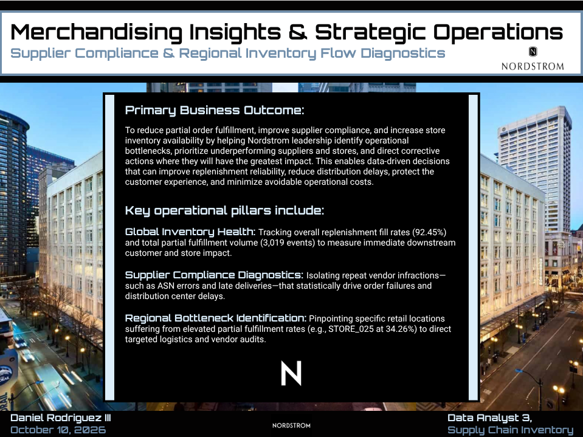
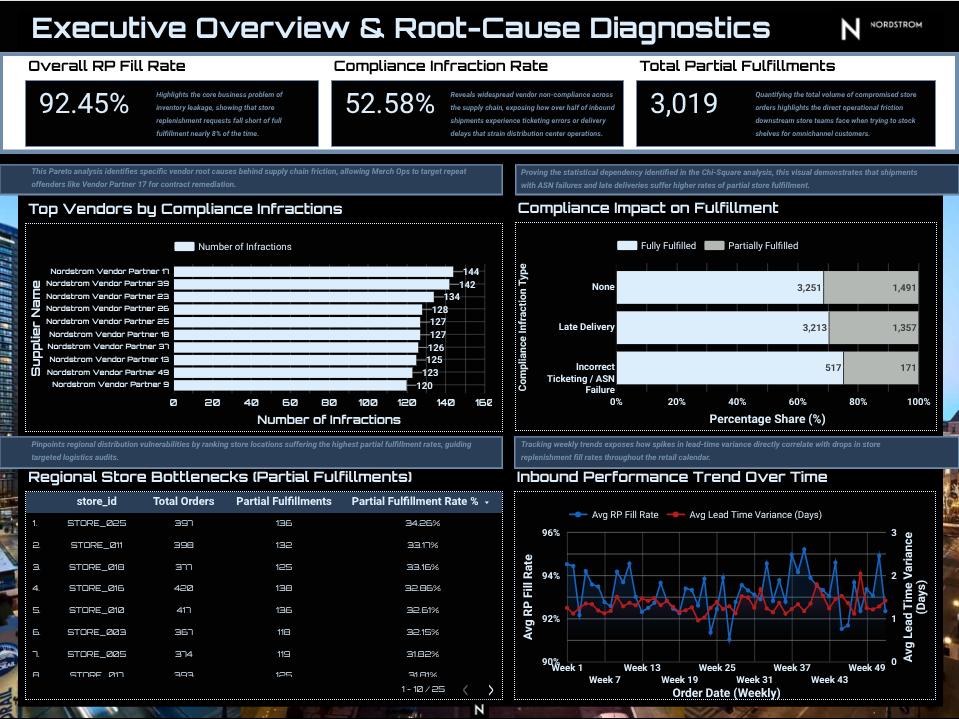

# Nordstrom MISO Inventory Flow & Supplier Compliance Analytics

## Overview
This repository contains an end-to-end data analytics and engineering project built for the Data Analyst 3 role within Nordstrom's MISO Inventory team. It showcases advanced SQL data warehousing in Google BigQuery, Python-based data generation and orchestration, inferential statistical modeling (Chi-Square testing), and Looker Studio executive dashboarding focused on supplier compliance and regional fulfillment bottlenecks.

## Repository Structure
* `/data`: Raw synthetic relational datasets (suppliers, shipments, store replenishment).
* `/sql`: BigQuery SQL scripts for cleaning, staging, and dimensional modeling (`fact_inventory_flow`).
* `/scripts`: Google Colab notebooks for synthetic data generation and statistical diagnostic analysis.
* `/dashboard`: Looker Studio schema and operational dashboard configuration specifications.

## Dashboard Snapshot
* **Intro Page**

  

  
* **Page 1** -`Executive Overview & Root Cause Diagnostics`

    

## Getting Started
1. Clone the repository.
2. Execute `synthetic_data_generator.ipynb` in Google Colab to generate relational test CSVs.
3. Upload CSVs into your Google BigQuery project (`driiiportfolio`).
4. Run SQL scripts sequentially (`01_data_cleaning_normalization.sql` and `02_dimensional_modeling.sql`) to build production analytical tables.
5. Connect Looker Studio to `fact_inventory_flow` using the provided dashboard configuration guide.
